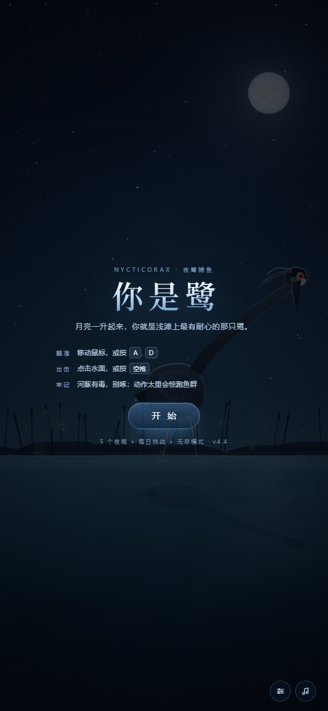
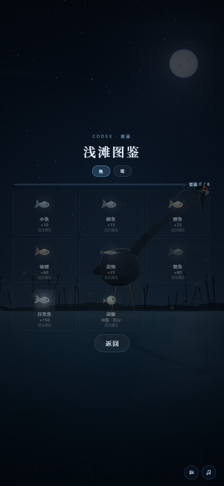
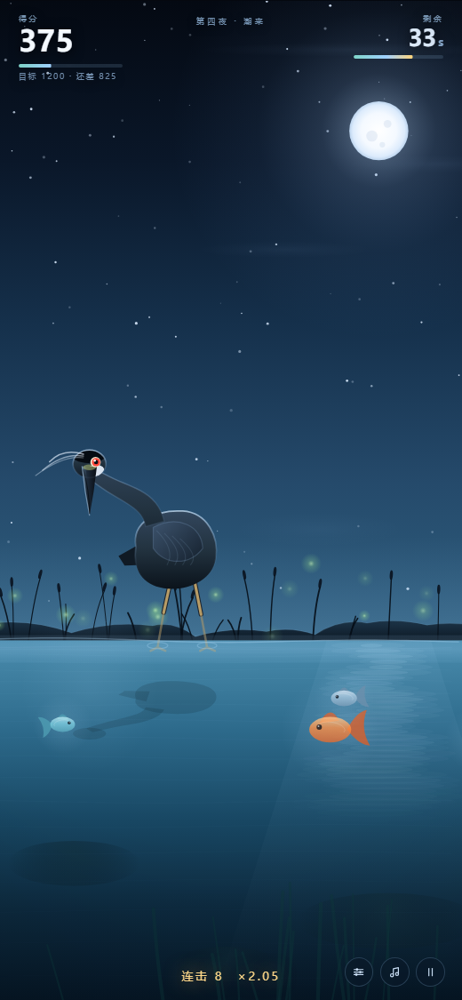

# 你是鹭 · 月下浅滩

> 月亮一升起来，你就是浅滩上最有耐心的那只鹭。

一个用原生 Canvas + WebAudio 写的夜鹭捕鱼小游戏。**单文件、零依赖、零外部素材**——所有画面都是代码画的，所有声音都是实时合成的。



## 玩法

| 操作 | 电脑 | 手机 |
| --- | --- | --- |
| 瞄准 | 移动鼠标，或按 `A` `D` | 按住屏幕左右拖动 |
| 出击 | 点击水面，或按 `空格` | 抬起手指 |
| 暂停 | `P` / `Esc` | 右下角暂停键 |

- 长喙入水的瞬间，落在喙正下方的那条鱼才算抓住
- **河豚有毒**，啄到扣分并僵直；**动作太重会惊跑鱼群**
- 连击越高倍率越高（最高 ×3）；**月食期间得分翻倍**

## 内容

- **5 个正片夜晚** + **4 个隐藏关**（集齐 15 ★ 解锁）：雨夜、荷塘、雾夜、月食
- **组合关**：风雨（雨+雾）、血雾（月食+雾）
- **每日挑战**：按日期抽一种玩法组合，同一天鱼群固定
- **无尽模式**：越活越难
- **图鉴**：8 种鱼，遇见即可收录；集齐解锁彩蛋皮肤「金鹭」
- **5+1 套皮肤**：夜鹭 / 白鹭 / 苍鹭 / 朱鹮 / 月影鹭 / 金鹭




## 一些实现细节

- **程序化美术**：天空渐变、芦苇剪影、鱼、夜鹭、月亮、雨丝、雾团、荷叶，全部是 Canvas 路径与渐变
- **程序化音频**：夜间铺底（和弦进行 + 琶音）与夜鹭的「呱」（锯齿波 + 带通共振 + 32Hz 喉音抖动）全部实时合成，没有任何音频文件
- **入场动画**：入夜 → 猫头鹰滑过 → 夜鹰低掠 → 镜头缓缓推近芦苇边一个不动的影子（点击可跳过）
- **多端适配**：横屏 960×600、竖屏自适高度，画布居中、HUD 跟随视口

## 运行

直接用浏览器打开 `index.html` 即可；或者起一个静态服务：

```bash
python -m http.server 8080
# 打开 http://localhost:8080
```

**GitHub Pages**：仓库 Settings → Pages → Source 选 `main` / `root`，即可通过
`https://<你的用户名>.github.io/<仓库名>/` 访问。

## 目录

```
index.html          # 主版本（单文件，直接可跑）
xiaohongshu/        # 小红书小工具版：index.html + app.js（脚本外置、无外链）
build_xhs.py        # 从主版本生成小红书包的脚本
assets/             # 截图与平台素材
```

### 小红书版

小红书小工具容器禁止内联脚本、禁止联网、禁止 `fetch`/剪贴板/下载等能力，所以 `xiaohongshu/` 是独立产物：

- 脚本外置为 `app.js`，事件全部 `addEventListener`
- 战报「保存图片」走容器 `saveImageToPhotosAlbum`，「发笔记」走 `postNote`
- 移除了排行榜与所有 B 站相关代码
- 为 Chrome 61 基线补了 flex `gap` / `min()` / `env()` 的回退

生成方式：

```bash
python build_xhs.py     # 输出 xiaohongshu/，再压缩成 zip 上传
```

## 兼容性

- 现代浏览器（Chrome / Edge / Safari / Firefox）完整可用
- 主版本内含 B 站 Toy SDK 的 `<script src>`，在非 B 站环境下会加载失败并自动降级，不影响游戏

## License

MIT
